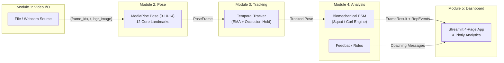
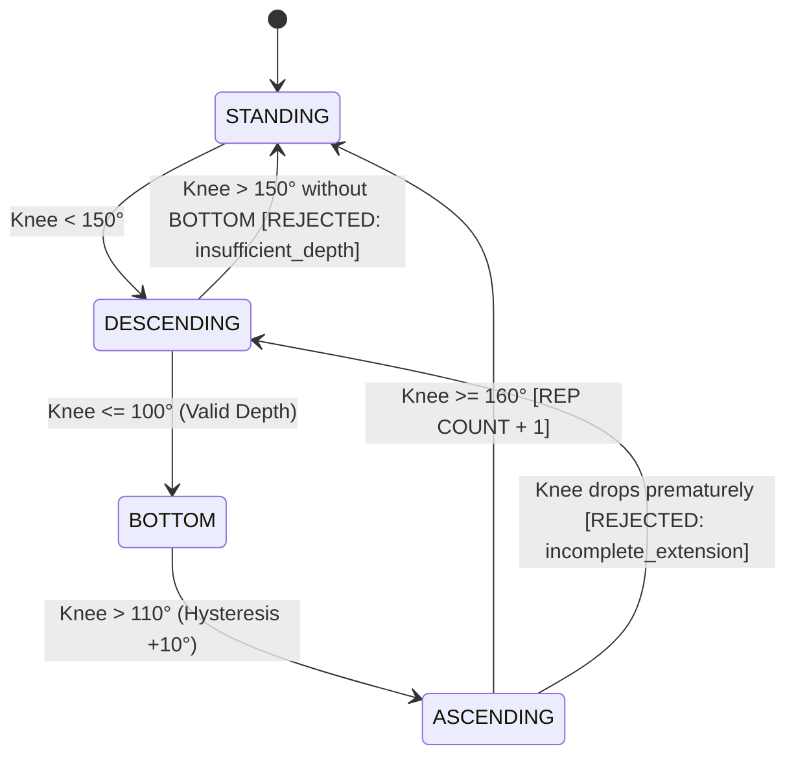
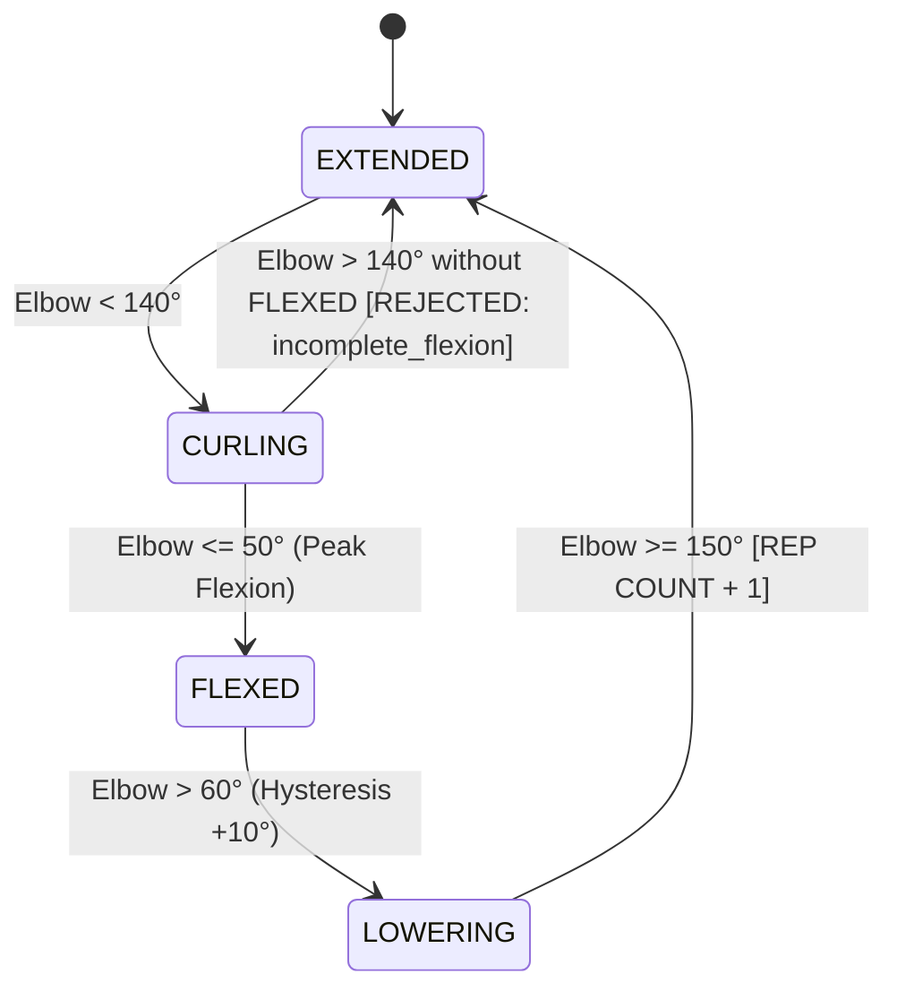

# Smart Gym Assistant — AI Workout Tracker Using Computer Vision

**Academic Project:** Computer Engineering — Visual Tracking & Intelligent Applications (2026-2027)  
**Authors:** Loua Ben Afia & Abir Rouag  
**Supervisor:** Dr. Rihab Laajili, Polytechnic Institute  

---

## 1. Overview & Biomechanical Philosophy

The **Smart Gym Assistant** is a camera-agnostic, edge-first Computer Vision system that transforms standard video footage (smartphones, recorded MP4/AVI/MOV files, or real-time webcams) into structured biomechanical feedback.

### Problems Solved in Solo Resistance Training
1. **Lost Counts:** Losing track of repetitions mid-set due to physical fatigue.
2. **Form Degradation:** Subtle postural breakdowns (knee collapse, trunk lean, shoulder swing) go unnoticed without real-time feedback.
3. **Inconsistency:** Lack of objective, quantified range of motion and velocity metrics over time.
4. **Commercial Opaque "Black-Box" Solutions:** Relying on proprietary hardware, subscriptions, or uninterpretable neural network outputs.

### Engineering Philosophy
This system is built upon **explainability and mathematical transparency**:
- **5 Decoupled Modules:** Video I/O → Pose Estimation → Temporal Tracking → Exercise Analysis → Dashboard.
- **Deterministic Finite State Machines (FSM):** Repetitions are strictly validated only when the user passes through every biomechanical state in order. Reversals or partial depth attempts are **cleanly rejected** (`rejected_attempts + 1`) and diagnosed with human-readable coaching cues.
- **Pure Vector Geometry:** Angles (knee, hip, ankle, elbow, trunk inclination) are calculated via Euclidean vector trigonometry with aspect-ratio correction and automatic body-side visibility selection.
- **No Streamlit Dependency in `core/`:** The entire tracking engine operates as an independent Python library with zero UI dependencies.

---

## 2. System Architecture



---

## 3. Finite State Machines (FSM)

### 3.1 Squat FSM (4 States)

- **Monitored Variables:** Knee flexion, Hip angle, Ankle angle, Trunk inclination.
- **Biomechanical Guardrails:**
  - `insufficient_depth`: "Go lower — squat depth not reached" (reversed before knee $\le 100^\circ$).
  - `excessive_trunk_lean`: "Keep your chest up — reduce forward lean" (trunk $> 45^\circ$).
  - `incomplete_extension`: "Stand up fully" (failed to return to $\ge 160^\circ$).

### 3.2 Bicep Curl FSM (4 States)

- **Monitored Variables:** Elbow flexion, Shoulder displacement drift.
- **Biomechanical Guardrails:**
  - `incomplete_flexion`: "Curl higher — complete peak contraction" (never reached $\le 50^\circ$).
  - `shoulder_compensation`: "Keep your shoulder still — avoid swinging" (shoulder drifted $> 0.08 \times \text{torso length}$).

---

## 4. Installation & Quickstart

### Prerequisites
- Python 3.10 or 3.11
- Modern laptop or desktop CPU (no GPU required; runs at $\ge 20$ FPS on modern processors)

### Step 1: Clone and Create Virtual Environment
```bash
git clone <repository-url>
cd CNN
python -m venv .venv

# On Windows:
.\.venv\Scripts\activate

# On Linux/macOS:
source .venv/bin/activate
```

### Step 2: Install Dependencies
```bash
pip install -r requirements.txt
```

### Step 3: Run the Dashboard
```bash
streamlit run app/Home.py
```
Open your browser at `http://localhost:8501`.

---

## 5. Running on Kaggle

The project is fully adapted to run headlessly in **Kaggle Notebooks**:

### Option A: Import Ready-Made Kaggle Notebook
1. Open [kaggle.com/code](https://www.kaggle.com/code) -> **New Notebook** -> **File** -> **Import Notebook**.
2. Upload `kaggle_notebook.ipynb` (or `kaggle/smart_gym_kaggle.ipynb`).
3. Click **Run All**. The notebook runs tests, analyzes video, embeds the annotated video in the notebook, and displays interactive Plotly charts!

### Option B: Headless Batch Processing CLI
```bash
python run_kaggle.py \
  --video data/videos/squat_sample.mp4 \
  --exercise Squats \
  --out_video output_annotated.mp4 \
  --out_json session.json \
  --out_csv reps.csv
```

### Option C: Launch Streamlit Web UI on Kaggle via Cloudflare Tunnel
In a Kaggle notebook cell:
```python
import subprocess, time, os

# 1. Start Streamlit headless in background
subprocess.Popen(["streamlit", "run", "app/Home.py", "--server.port=8501", "--server.headless=true"])
time.sleep(3)

# 2. Open public Cloudflare tunnel
if not os.path.exists("cloudflared"):
    !wget -q -nc https://github.com/cloudflare/cloudflared/releases/latest/download/cloudflared-linux-amd64 -O cloudflared
    !chmod +x cloudflared

!./cloudflared tunnel --url http://localhost:8501
```

---

## 6. Running Tests

Unit tests cover vector trigonometry, coordinate EMA smoothing, occlusion carry-forward, squat FSM, curl FSM, and feedback translation:
```bash
pytest -q
```

---

## 6. How to Add a New Exercise

The architecture is designed for seamless extensibility. Adding a new exercise requires writing **one new class** without modifying existing modules:

1. Create `core/exercises/new_exercise.py`:
   ```python
   from core.exercises.base import Exercise
   from core.models import PoseFrame, FrameResult, RepEvent

   class OverheadPressExercise(Exercise):
       def __init__(self, config=None):
           super().__init__(name="Overhead Press", config=config)
           self.current_state = "RACK"

       def update(self, frame: PoseFrame, image_width: int, image_height: int, side_override="auto") -> FrameResult:
           # 1. Calculate joint angles using core.geometry
           # 2. Advance FSM states
           # 3. Return FrameResult
           pass

       def reset(self):
           super().reset()
           self.current_state = "RACK"
   ```
2. Register the class in `core/exercises/__init__.py`:
   ```python
   EXERCISE_REGISTRY["Overhead Press"] = OverheadPressExercise
   ```
3. Add threshold defaults in `config/thresholds.yaml`.

---

## 7. Benchmark Evaluation Framework

To evaluate accuracy against annotated test footage:
```bash
# Generate synthetic demo test video (if no raw video at hand)
python -m scripts.generate_demo_video --exercise squat --out data/videos/demo_squat.mp4
python -m scripts.generate_demo_video --exercise curl --out data/videos/demo_curl.mp4

# Run evaluation CLI
python -m evaluation.evaluate --gt evaluation/ground_truth_template.csv --videos data/videos --out evaluation/report.csv
```
This generates:
- `evaluation/report.csv`: Complete metrics per video.
- `evaluation/report.md`: Benchmark report with Repetition Count MAE, Latency, and Visibility grouped by lighting, angle, and occlusion.

---

## 8. Tech Stack

- **Computer Vision:** OpenCV (`opencv-python`), MediaPipe Pose (`mediapipe==0.10.14`)
- **Signal Processing & Maths:** NumPy, SciPy (`scipy.signal`)
- **Web UI:** Streamlit (`app/Home.py`)
- **Visual Analytics:** Plotly Graph Objects
- **Configuration & Quality:** PyYAML, pytest
